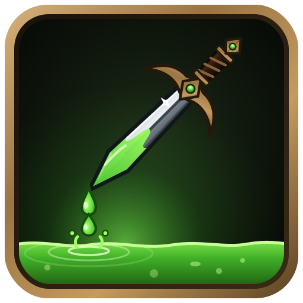

<p align="center">
  
</p>

<h1 align="center">PoisonSlot</h1>

<p align="center">
  A small World of Warcraft: Forever addon for Rogues. It puts your poisons on the weapon slots where they belong and reminds you when one runs out.
</p>

<p align="center">
  <a href="https://github.com/nikpietanze/PoisonSlot/releases/latest"></a>
  <a href="https://www.curseforge.com/projects/1822005"></a>
  <a href="LICENSE"></a>
</p>

- **Pick a poison per hand.** Each weapon slot on the Character panel gets a small vial. Left-click it to see the poisons in your bags, then click one to apply it to that weapon.
- **Favorite one per hand.** Click the star on a poison to make it that hand's favorite. Main hand and off hand keep separate favorites, saved per character.
- **Apply the favorite in one click.** Right-click a weapon's vial to apply its favorite. If that hand has no favorite, right-click does nothing.
- **Reminders you can click.** When a weapon has no poison, a tile for that hand lights up with the action bar's proc glow. In the last 10 seconds before a poison wears off, the tile counts down, turning red and showing tenths at the end. Left-click a tile to reapply the last poison you put on that weapon, from your bags, action bar or PoisonSlot (until you've poisoned it once, it uses the hand's favorite). Right-click it to snooze it until your next loading screen, or Shift-right-click to silence it until you poison that weapon again (handy when you're out of poisons). A lone reminder sits in the middle; when both show, they spread out evenly around it.
- **Edit Mode support.** Move and size the reminders in Blizzard's Edit Mode, with a position saved for each Edit Mode layout.

No poison bar, no chat spam, no automation. Every application is one real click from you.

## Reminders

Reminders stay quiet while dead and on flight paths. Almost everything else is a setting under **Esc → Options → AddOns → PoisonSlot** (or type `/pslot`, or click PoisonSlot in the minimap's addons menu):

| Section | Settings |
|---|---|
| General | Animations, tooltips |
| Reminders | Show reminders (master switch), main hand, off hand, countdown before it runs out, click to reapply, quiet in towns and inns, hide in combat, sound when a poison runs out |
| Reminder appearance | Icon size (24 to 80 px), spacing, horizontal or vertical layout, missing glow (proc, pixel, soft pulse or none), status text, hand badges, plus Preview, Move and Reset |
| Character panel | Poison buttons on weapon slots, right-click vial to apply favorite, Clear favorites |

Options that depend on another one gray out while it's off. The panel's **Defaults** button restores everything. The sound list includes your SharedMedia sounds if an addon providing LibSharedMedia is installed.

To move the reminders, click **Move** (or type `/pslot move`) to open Edit Mode, then drag them. Select them in Edit Mode to change their size, spacing, layout, glow and text right there.

If a favorite's or last poison's exact rank isn't in your bags, PoisonSlot uses the best rank of that same poison you're carrying. It never swaps in a different poison.

### Combat

WoW doesn't let addons change clickable buttons during combat. If a reminder appears mid-fight, it becomes clickable once combat ends. A reminder that was already clickable when combat started stays clickable for the rest of the fight. Applying a poison still follows the game's normal rules: it has a cast time and asks before replacing an existing poison.

## Poison order

The menu ranks poisons for general PvE. Instant Poison comes first on both hands. In a raid, the off hand puts Occult Poison first and Deadly Poison second for longer fights. Poisons you can use come first, and each type lists its highest rank first.

## Commands

| Command | What it does |
|---|---|
| `/pslot` | Open the options |
| `/pslot preview` | Preview the reminders |
| `/pslot move` | Open Edit Mode to move the reminders |
| `/pslot unlock` / `/pslot lock` | Drag the reminders without Edit Mode (mouse wheel nudges), then lock them |
| `/pslot reset` | Put the reminders back in their default spot |
| `/pslot status` | Print client, weapon, poison, favorite and last-poison details for bug reports |

## Install

Download the latest release and extract it into your AddOns folder:

```
World of Warcraft/_forever_/Interface/AddOns/PoisonSlot/PoisonSlot.toc
```

You can also clone this repo into that folder as `PoisonSlot`. Target client: WoW Forever, Interface `16001`.

## Bugs and ideas

Open an [issue](https://github.com/nikpietanze/PoisonSlot/issues). For bugs, include the output of `/pslot status` and any Lua error text (BugSack makes this easy). Pull requests are welcome. See [CONTRIBUTING.md](CONTRIBUTING.md).

## License

MIT. See [LICENSE](LICENSE).

PoisonSlot bundles these libraries unmodified, each under its own license in its folder under `Libs`:

- [LibStub](https://www.wowace.com/projects/libstub) (public domain)
- [LibCustomGlow](https://github.com/Stanzilla/LibCustomGlow) (MIT)
- [LibEditMode](https://github.com/p3lim-wow/LibEditMode) by p3lim (custom license that allows bundling unmodified)
